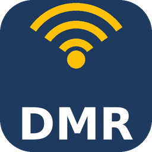
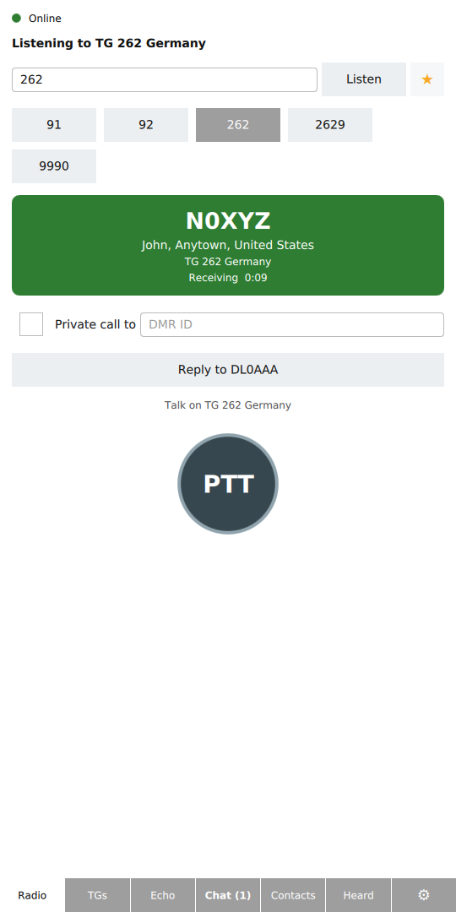
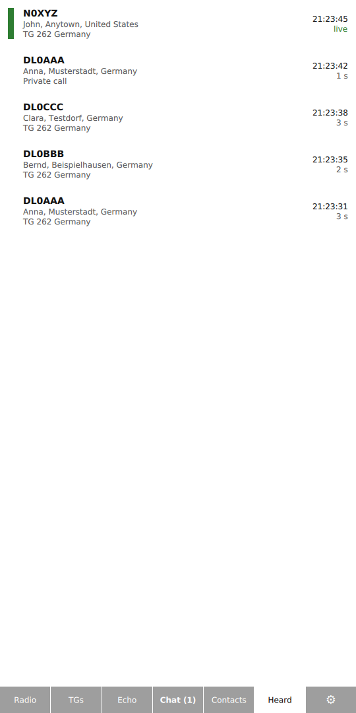
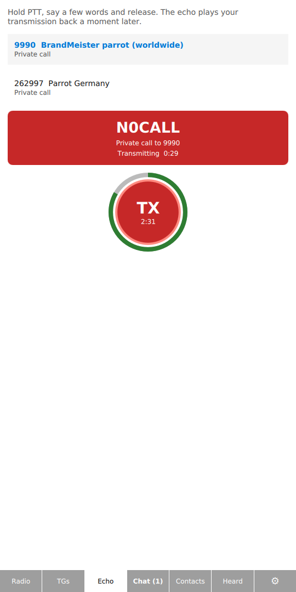
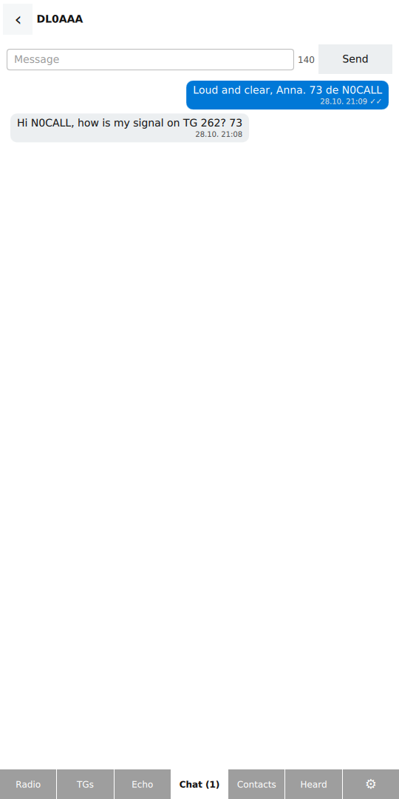
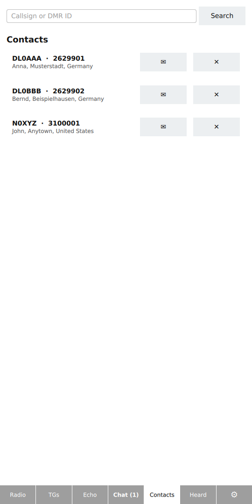
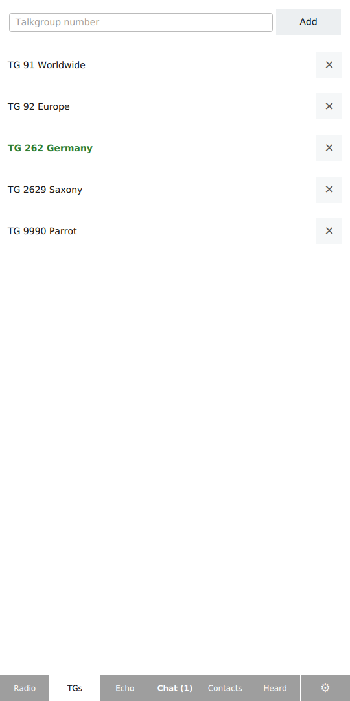
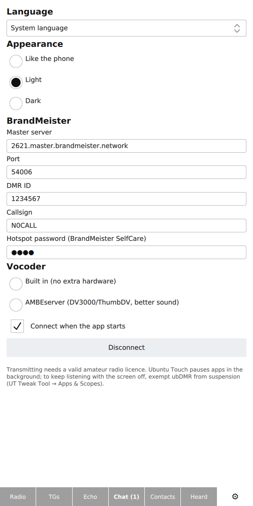
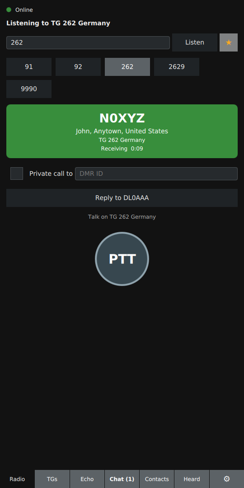

<p align="center">
  
</p>

# ubDMR

A BrandMeister DMR client for Ubuntu Touch, in the spirit of HamTalk and
VoxDMR: monitor talkgroups, see who is talking, and talk back with
push-to-talk, without a radio or hotspot.

[](../../actions/workflows/build.yml)

## Screenshots

| Radio | Last heard | Echo test | Chat |
| :---: | :---: | :---: | :---: |
|  |  |  |  |

| Contacts | Talkgroups | Settings | Dark mode |
| :---: | :---: | :---: | :---: |
|  |  |  |  |

All callsigns, names and DMR IDs in the screenshots are fictional; they come
from a local stand-in server (`tools/screenshots/`), not from the network.

## Features

- Logs in to a BrandMeister master server as an *Open DMR Terminal*
  (Rewind protocol, UDP port 54006).
- Monitors one talkgroup at a time, with favourites for quick switching.
- Receives private calls to your own DMR ID; *Reply* calls back.
- Push-to-talk to the talkgroup or privately to any DMR ID.
- Shows callsign, name and location of the talking station (radioid.net) and
  talkgroup names (BrandMeister API), cached on the phone.
- *Last heard* list of the recent calls; tap a station to call it privately.
- *Echo* page: talk to an echo service (BrandMeister parrot 9990 or 262997)
  and hear yourself back. The PTT button shows a shrinking ring and
  the time left before the 3-minute transmit time-out.
- *Chat*: pick a saved contact and write a text message (✓✓ when
  delivered); incoming private and talkgroup messages with an unread counter
  on the tab, answered in their conversation. ✉ on a contact starts one too.
- *Contacts*: search radioid.net by callsign (`DL5U*` for all starting with
  DL5U) or DMR ID, save stations, tap one to call it privately.
- Favourite talkgroups: add and remove them on the *Talkgroups* page or with
  ☆ on the radio page; they show up as quick buttons.
- Light and dark appearance: follows the phone's theme (Lomiri SuruDark /
  Ambiance, live), or fixed in *Settings → Appearance*.
- English, German, French, Spanish, Italian and Dutch. The app follows the
  phone's language; *Settings → Language* picks another one at once.

## What you need

1. **A DMR ID** from [radioid.net](https://radioid.net) and an amateur radio
   licence (transmitting without one is illegal).
2. **A BrandMeister hotspot password.** Log in to BrandMeister SelfCare,
   enable *Hotspot Security* in your profile and set a password. The app
   logs in with your DMR ID (or a 9-digit hotspot ID such as `262123401`)
   and that password.
No extra hardware is needed: DMR voice (AMBE+2) is encoded and decoded on
the phone by the built-in software vocoder, as HamTalk and VoxDMR do.

Optionally, for better sound, the app can use a hardware vocoder (DV3000,
ThumbDV, DVstick 30 …) behind [AMBEserver](https://github.com/marrold/AMBEServer)
on a PC or Raspberry Pi the phone can reach (LAN, VPN):

```bash
AMBEserver -i /dev/ttyUSB0 -s 460800 -p 2460   # ThumbDV; DV3000 hat: -s 230400
```

The app switches the chip to AMBE+2 2450 bit/s without FEC (rate index 34)
at connect time, so the server needs no further configuration.

## Using it

Open *Settings*, enter master server (default `2621.master.brandmeister.network`,
any BrandMeister master works), DMR ID, callsign and hotspot password, choose
the vocoder, then *Connect*. The dot on the radio page turns green when the
app is ready to talk. Hold the PTT button to talk. A changed vocoder choice
takes effect on the next *Connect*.

## Translations

Texts are written in English inside `qsTr()` / `tr()`; `i18n/ubdmr_<lang>.ts`
hold the translations and are compiled into the app. After changing texts,
refresh the files and translate the new entries (Qt Linguist or by hand):

```bash
docker run --rm -v "$PWD":/w -w /w clickable/amd64-20.04-arm64 \
    sh -c 'for l in de fr es it nl; do lupdate -no-obsolete src qml -ts i18n/ubdmr_$l.ts; done'
```

A new language only needs a new `i18n/ubdmr_<code>.ts`; it appears in the
language list automatically.

## Building

```bash
clickable build          # arm64 click package in build/
clickable                # build, install and start on the phone (adb)
clickable logs           # app output
```

### On GitHub

*Actions → Build click → Run workflow* builds the arm64 click package with
clickable; it can be downloaded from the run's *Artifacts*. Ticking
*Ergebnis als GitHub-Release veröffentlichen*, or pushing a tag
(`git tag v0.1.0 && git push --tags`), also publishes it as a release.
The workflow is in `.github/workflows/build.yml`.

### Screenshots

The README screenshots are taken in a desktop build with fictional data and
no network access:

```bash
docker build -t ubdmr-shots tools/screenshots
docker run --rm --network none -e PTT_Y=410 -v "$PWD":/src ubdmr-shots \
    bash /src/tools/screenshots/shoot.sh      # writes docs/screenshots/
```

## Layout

| File | What it does |
| --- | --- |
| `src/rewindclient.*` | Rewind protocol: login, keep-alive, subscriptions, voice packets; `_text.cpp` holds text messages |
| `src/fulllc.*` | DMR full link control (caller and destination IDs) with RS(12,9) |
| `src/ambeframe.*` | AMBE+2 72-bit (network, with FEC) ↔ 49-bit (vocoder) frames |
| `src/vocoder.h` | Interface of the two vocoders |
| `src/softwarevocoder.*` | Built-in vocoder: mbelib-neo decoder, OP25 encoder, AMBE+2 bit order |
| `src/ambeservervocoder.*` | Optional AMBEserver/DV3000 packet protocol over UDP |
| `src/audioplayer.*`, `src/audiorecorder.*` | Speaker with jitter buffer, microphone in 20 ms frames |
| `src/idlookup.*` | radioid.net and BrandMeister talkgroup names, disk cache, station search |
| `src/lastheardmodel.*` | Recent calls for QML |
| `src/systemtheme.*` | `SystemTheme` in QML: watches the phone's Lomiri theme (dark or not) |
| `src/languagemanager.*` | `Language` in QML: system or chosen UI language, live switching |
| `src/radiocontroller*.cpp` | `Radio` in QML: ties it all together; `_tx` holds transmitting |
| `qml/` | `main.qml` (window, settings, favourites, tabs) and one file per page/component |
| `i18n/` | Translations (`.ts`), compiled to `.qm` at build time |
| `third_party/opendmr/` | AMBE+2 decoder and encoder sources, unchanged (see its README) |

## Protocol notes

- Rewind packets: `"REWIND01"`, then type, flags, sequence and payload length,
  all little-endian. Login: KEEP_ALIVE (service 0x21, DMR ID) → server
  CHALLENGE (4 bytes) → AUTHENTICATION = SHA-256(challenge + password) →
  server KEEP_ALIVE. Keep-alive every 5 s; 15 s of silence means log in again.
- Terminals get no SUPER_HEADER. A call arrives as a DMR voice header
  (0x0911, three times), AUDIO_FRAMEs (27 bytes = three 72-bit AMBE frames =
  60 ms) and a terminator (0x0912). Header and terminator carry the decoded
  full LC: 9 bytes (call type, destination, source) plus RS(12,9) parity
  masked with 0x96 / 0x99 (`FullLc`). Transmitting sends the same sequence;
  DMR data and audio packets carry the real-time flag and their own sequence
  counter.
- Text messages are MESSAGE_TEXT (0x0a10: source, destination, option
  0 = private / 128 = talkgroup, length, UTF-16LE text); the receiver of a
  private message answers with MESSAGE_STATUS (0x0a11, status 0x08 =
  delivered). The terminal logs in with the plain DMR ID, never with a
  hotspot suffix.
- A wrong hotspot password gets no answer at all after the challenge
  response; the app reports a rejected login after 8 s of silence.
- The 72-bit frames are in air-interface order (interleaved, C1 scrambled,
  Golay-protected). `AmbeFrame` converts them with the tables from dmr_utils;
  the DMR silence frame maps to the well-known AMBE+2 silence `F801A99F8CE080`.

- The built-in encoder delivers the nine AMBE+2 parameters; `SoftwareVocoder`
  places their bits in the codec's own order (low bits at the end of the
  frame, as mbelib reads them) and sets the encoder gain (a log2 offset) so
  that the encoder + decoder chain keeps the input level.

## Platform constraints

- **Build against Qt 5.12** (`ubuntu-sdk-20.04`): QML imports stop at 2.12,
  `Connections` uses the `onSignal:` form.
- **Lomiri suspends background apps**, which stops audio and lets the
  BrandMeister session time out. The app logs in again on resume. To keep
  listening with the screen off, exempt ubDMR from suspension in
  *UT Tweak Tool → Apps & Scopes*.
- **Permissions:** `networking` (BrandMeister, vocoder, lookups), `audio`
  (speaker) and `microphone` (PTT). Ubuntu Touch asks for the microphone on
  the first transmission.
- **`QT_QUICK_CONTROLS_STYLE=Default` is set in `main.cpp`**, and `main.qml`
  sets the window palette from its colour properties (light and dark set).
  Use `AppLabel` and `AppField` instead of bare `Label`/`TextField`, and take
  colours from `app.color*`, never literal values in the pages.
- **Dark mode detection** reads `~/.config/lomiri-ui-toolkit/theme.ini`,
  which the confined app may read.
- Settings, including the hotspot password, are stored in plain text in
  `~/.config/ubdmr/ubDMR.conf` on the phone.

## Debugging

```bash
adb shell 'journalctl --user -f | grep -a -E "Rewind|Radio|Ambe|Audio"'
adb shell 'cat ~/.local/share/ubdmr/ubDMR/ubdmr.log'
adb shell 'dmesg | grep ubdmr | grep DENIED'      # AppArmor denials
```

## Licence

GPL-3.0-or-later (see `LICENSE`), as required by the OP25 encoder in
`third_party/opendmr/encoder`. The AMBE+2 codec may be covered by patents in
some countries; the software vocoder is provided for non-commercial amateur
radio use.
